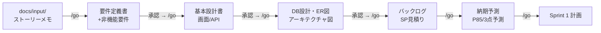

# AI上流工程スターター

**Claudeにシステム開発の上流工程(要件定義〜設計〜タスク洗い出し〜納期予測)をやらせるためのプロジェクトテンプレート**です。
「要件定義だけで開発を始めてタスクが膨らみ、納期が溶ける」を防ぐ仕組みが最初から入っています。

- 覚えるコマンドは実質1つ: **`/go`**
- 成果物はすべて Markdown + Mermaid で `docs/` に生成され、Gitで差分レビューできます
- AIが書き、**人間が承認**し、**スクリプトが検査**する3層構造。コンテキスト切れからの自動復帰つき

---

## 🚀 クイックスタート(5分)

前提: [Claude Code](https://code.claude.com)(`npm i -g @anthropic-ai/claude-code`)、Python 3.9+、[gh CLI](https://cli.github.com)

```bash
# 1. このリポジトリを自分のプロジェクトとして作る
gh repo create my-project --private --template 【このリポジトリ】 --clone
cd my-project
#   (テンプレートにしていない場合は clone → リモート差し替えでもOK)

# 2. インプットを置く(サンプルを同梱済み。実案件なら自分のメモに差し替え)
ls docs/input/ストーリーメモ.md   # ← 習い事教室SaaS「LessonHub」のサンプル

# 3. 開始
claude
```

セッションが開いたら、打つのはこれだけです:

```
/go
```

あとは **「AIの質問に答える → 成果物を承認する → また `/go`」** の繰り返しで、
要件定義から納期予測まで進みます。途中でセッションが切れても、次の `/go` が続きから再開します。

## 🔄 何が起きるか(全体フロー)



各工程の承認前には機械チェック(ID整合・Mermaid構文・ゲート判定)が自動で走り、
人間は「内容が正しいか」だけをレビューすればよい状態で成果物が出てきます。

## 📋 日常で使うコマンド

| コマンド | いつ使う |
|---|---|
| `/go` | **基本これだけ。** 現在地を自動判定して次の一手を実行 |
| `/go 全部` | 承認を待たず最後まで一気にドラフト生成(【未承認ドラフト】マーク付き) |
| `/change 〜したい` | 仕様変更・追加要望が出たとき(勝手に実装せず変更提案書で影響分析) |
| `/sprint retro` | スプリント終了時(実績記録 → 納期予測の自動更新まで) |
| `/kaizen` | プロセスに不満が溜まったとき(データに基づきスキル・憲法を改訂) |
| `/diagnose 状況` | **既に走っていて遅延中のプロジェクト**に導入するときの最初の1発 |

<details>
<summary>個別コマンド一覧(上級者向け — 全部 /go から自動で呼ばれます)</summary>

| コマンド | やること |
|---|---|
| `/req` `/design` `/db` `/arch` | 要件定義 / 基本設計 / DB設計・ER図 / アーキテクチャ図を個別実行 |
| `/backlog` `/release` | バックログ分解・SP見積り / 納期予測(モンテカルロP85含む) |
| `/sprint plan\|refine\|review\|retro\|daily` | スプリント運営支援 |
| `/check` | 機械チェック一括(ID整合・Mermaid・実装開始ゲート) |
| `/resume` | 中断した工程の再開(/goが内部で自動実行) |
| `/docreview <パス>` | ドキュメントのAIレビュー(独立コンテキストで辛口採点) |
| `/upstream` | 上流工程パイプラインの明示実行 |

</details>

## 📁 リポジトリ構成

```
├── README.md            ← このファイル
├── CLAUDE.md            ← AIへの地図(プロジェクト名・スタックを記入して使う)
├── .claude/
│   ├── skills/          ← 各工程の実行手順(AIの作業マニュアル)
│   ├── commands/        ← /go などのスラッシュコマンド
│   ├── agents/          ← 調査用サブエージェント(コンテキスト節約)
│   └── settings.json    ← hooks: docs編集時の自動整合チェック等
├── tools/               ← AI不使用のスクリプト(ID整合検査・納期計算・状態管理)
├── templates/           ← ドキュメントのひな形 全17種(憲法〜変更提案書)
├── docs/                ← ★成果物はすべてここに生成される(唯一の真実)
│   ├── input/           ← インプット置き場(ストーリー・メモ)
│   ├── issues/          ← 課題管理表(未確定事項の集約先)
│   └── changes/         ← 変更提案書のアーカイブ
├── .github/workflows/   ← PR時の自動ドキュメント検査(docs-checks.yml)
├── guide/               ← 運用ガイド(スクラム運用・コンテキスト管理・自動化設計)
└── examples/            ← 生成物のサンプル(品質の目線合わせ用)
```

## 👥 チーム運用の要点(3人チーム想定)

1. **AIは起案者、人間が決定者。** 成果物の管理ヘッダに承認者が記名されるまで次工程に進まない
   (自分が作らせたものは自分で承認しない)
2. **仕様変更は `/change` 経由のみ。**「ついで実装」は禁止。影響分析 →「納期をずらす/他を削る/次に回す」の三択を決めてから着手
3. **納期は常に幅で扱う。** 対外コミットは `--simulate` のP85(85%の確率で守れる日付)を使う
4. **スプリント末に3点セット:** `/sprint retro` → 実績がvelocity.jsonに記録 → 納期予測が自動更新。予測が悪化したらその日のうちに共有
5. 詳細は [`guide/スクラム運用ガイド.md`](guide/スクラム運用ガイド.md) と [`guide/運用ガイド.md`](guide/運用ガイド.md)

## 🔧 トラブルシューティング

| 症状 | 対処 |
|---|---|
| コンテキストがいっぱい/セッションが落ちた | 新しいセッションで `/go`(続きから再開されます) |
| 今どこまで進んだか分からない | ターミナルで `python3 tools/pipeline.py status`(AI不要) |
| 生成物が正しいか不安 | `/check`(機械検査)→ `/docreview docs/○○.md`(AI辛口レビュー) |
| コマンドが補完に出ない | セッションを再起動。それでも出なければ自然文で指示すれば同じ動作 |
| AIが最初からやり直そうとする | 拒否してOK。「継続メモから再開して」と言う(禁止事項として設定済み) |

## ⚙️ オプション設定

- **夜間ドリフト検知**(設計書と実装のズレを毎晩自動検出しIssue起票):
  `.github/workflows/nightly-drift.yml.disabled` の `.disabled` を外し、
  リポジトリの Settings → Secrets に `CLAUDE_CODE_OAUTH_TOKEN` を登録(トークン消費に注意)
- **Mermaidのローカル検証**: `npm i -g @mermaid-js/mermaid-cli`(なくても簡易検証で動作)
- **プロジェクト憲法**: 要件定義が終わると `docs/00_プロジェクト憲法.md` の作成を提案されます。
  チームの不変ルールとして育ててください(以降、AIは憲法違反の指示を拒否します)

---

**設計思想**(なぜこの構成なのか)は [`guide/自動化・リトライ設計ガイド.md`](guide/自動化・リトライ設計ガイド.md) を参照。
一言で: *判断はAI、検査はスクリプト、決定は人間。会話コンテキストはいつ消えてもよいキャッシュとして扱う。*

