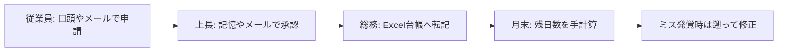
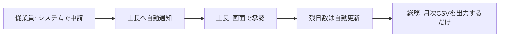

# 要件定義書 — 勤怠管理SaaS「KintaiOne」

| 項目 | 内容 |
|---|---|
| ドキュメントID | REQ-001 |
| プロジェクト名 | KintaiOne |
| バージョン | 1.0 |
| 作成者 | Claude (AI) |
| レビュー担当 | 佐藤(PO役)、田中(アーキテクト役) |
| 承認者 / 承認日 | 佐藤 / 2026-08-05 |
| ステータス | 承認済み |

## 改訂履歴

| 版 | 日付 | 変更内容 | 変更者 |
|---|---|---|---|
| 0.1 | 2026-08-01 | 初版ドラフト(AI生成) | Claude |
| 1.0 | 2026-08-05 | レビュー指摘反映、承認 | 佐藤 |

---

## 1. プロジェクトの背景と目的

### 1.1 解決したい課題

従業員30〜100名規模の中小企業では、勤怠管理が紙のタイムカードやExcelで行われており、
月末の集計に総務担当者が2〜3営業日を費やしている。また休暇申請が口頭・メールで行われるため、
残日数の管理ミスや承認漏れが頻発している。

### 1.2 目的とゴール(KPI)

| KPI | 現状 | 目標 | 測定方法 |
|---|---|---|---|
| 月次勤怠集計の作業時間 | 2〜3営業日 | 30分以内 | 導入企業へのヒアリング |
| 休暇申請の承認リードタイム | 平均3日 | 平均1日以内 | システムログ |
| 打刻修正依頼の件数 | 月20件程度 | 月5件以下 | システムログ |

## 2. 利用者(ステークホルダー)

| ロール | 説明 | 想定人数(1社あたり) | 利用頻度 |
|---|---|---|---|
| 従業員 | 打刻・休暇申請を行う | 30〜100名 | 毎日2回以上 |
| 承認者(上長) | 部下の申請を承認する | 3〜10名 | 週数回 |
| 管理者(総務) | 集計・マスタ管理・打刻修正 | 1〜2名 | 毎日 |

- 契約企業数の想定: 初年度10社 → 3年後100社(マルチテナント)

## 3. スコープ

### 3.1 今回のリリースでやること

Web打刻、休暇申請・承認ワークフロー、月次集計とCSV出力、従業員・部署マスタ管理。

### 3.2 今回のリリースでやらないこと(スコープ外)

| # | やらないこと | 理由 | 将来対応の可能性 |
|---|---|---|---|
| 1 | 給与計算・給与ソフト連携 | 集計CSVを人が取り込む運用で初期は十分 | Phase 2で検討 |
| 2 | ICカード・生体認証打刻 | ハード調達が必要。Web打刻で代替 | Phase 2 |
| 3 | シフト作成・シフト管理 | 対象顧客は固定勤務が中心 | 未定 |
| 4 | スマホネイティブアプリ | レスポンシブWebで代替 | Phase 2 |
| 5 | 残業の36協定アラート等の法令チェック | 要件が複雑。まず記録と集計に集中 | Phase 2で最優先 |
| 6 | 英語など多言語対応 | 国内中小企業向け | 未定 |

## 4. 業務フロー

### 4.1 現行業務フロー(As-Is) — 休暇申請

### 4.2 導入後業務フロー(To-Be) — 休暇申請

## 5. 機能要件

### 5.1 機能一覧

| 機能ID | 機能名 | 概要 | 対象ロール | 優先度 |
|---|---|---|---|---|
| F-001 | 認証・ログイン | メール+パスワード認証、パスワード再設定 | 全員 | MUST |
| F-002 | 出退勤打刻 | 出勤・退勤・休憩の打刻(Web) | 従業員 | MUST |
| F-003 | 勤怠実績の閲覧 | 自分の月次勤怠一覧の確認 | 従業員 | MUST |
| F-004 | 打刻修正申請 | 打刻漏れ・誤りの修正申請と承認 | 従業員/承認者 | MUST |
| F-005 | 休暇申請 | 有給・特別休暇の申請、残日数表示 | 従業員 | MUST |
| F-006 | 申請承認 | 休暇・打刻修正の承認/差戻し | 承認者 | MUST |
| F-007 | 月次集計・CSV出力 | 企業単位の勤怠集計とCSVダウンロード | 管理者 | MUST |
| F-008 | 従業員・部署マスタ管理 | 従業員の登録/無効化、部署と承認ルート設定 | 管理者 | MUST |
| F-009 | 休暇残日数の付与管理 | 有給付与日数の設定・自動付与 | 管理者 | SHOULD |
| F-010 | 通知(メール) | 申請・承認時のメール通知 | 全員 | SHOULD |
| F-011 | ダッシュボード | 未承認件数・当日の出勤状況の表示 | 承認者/管理者 | SHOULD |
| F-012 | 監査ログ閲覧 | 誰がいつ何を変更したかの閲覧 | 管理者 | COULD |
| F-013 | 祝日・会社休日カレンダー | 会社独自の休日設定 | 管理者 | SHOULD |

MUST 8 / SHOULD 4 / COULD 1(MUST比率 62% → レビューで F-009, F-013 をSHOULDへ降格済み)

### 5.2 ユーザーストーリーと機能の対応表

| ストーリーID | ユーザーストーリー | 対応機能ID |
|---|---|---|
| US-01 | 従業員として、出社時にすぐ打刻したい。打ち忘れても直せるようにしたい | F-002, F-004 |
| US-02 | 従業員として、有給の残りを見ながら休暇申請したい | F-005 |
| US-03 | 上長として、申請をまとめて確認し、その場で承認したい | F-006, F-011 |
| US-04 | 総務として、月末に全員分の勤怠をCSVで出して給与計算に使いたい | F-007 |
| US-05 | 総務として、入退社時に従業員情報を自分で管理したい | F-008, F-009 |

### 5.3 機能詳細(抜粋: F-002)

#### F-002: 出退勤打刻
- **概要**: 従業員がWeb画面から出勤・退勤・休憩開始・休憩終了を打刻する
- **入力**: 打刻種別(ボタン押下)。時刻はサーバ時刻を使用(クライアント時刻は使わない)
- **処理**: 同一種別の二重打刻をチェックし、勤怠実績に記録する
- **出力**: 打刻完了表示と当日の打刻履歴
- **例外・制約**: 日をまたぐ勤務(夜勤)は当リリースでは対象外(スコープ外#3に関連)【承認済み】

## 6. 外部インターフェース

| # | 連携先システム | 方向 | 内容 | 方式 |
|---|---|---|---|---|
| 1 | メール配信(Amazon SES) | 送信 | 申請・承認通知 | API |
| 2 | 給与計算ソフト | 送信 | 月次集計CSV(人手で取込) | CSVファイル |

## 7. データ要件(概要)

| データ | 初期件数 | 1年後想定 | 保持期間 |
|---|---|---|---|
| 契約企業 | 10 | 40 | 解約後1年 |
| 従業員 | 500 | 2,500 | 退職後、法定保存期間(労働関係書類として3年以上) |
| 打刻レコード | - | 約120万件/年 | 3年以上(労基法対応) |
| 申請レコード | - | 約6万件/年 | 3年以上 |

## 8. 制約条件

- **納期**: 2026-12-20 リリース(開発期間約4ヶ月)
- **予算**: インフラ月額 $500 以内(本番+検証)
- **体制**: 開発3名(フルスタック)、専任QA・専任インフラなし
- **技術制約**: チームの経験から TypeScript(Next.js / NestJS)+ PostgreSQL を採用
- **法規制**: 個人情報保護法(従業員情報)、労働基準法の記録保存(3年以上)

## 9. 前提条件・依存事項

- 契約企業側で管理者(総務)が初期マスタ登録を実施できること
- メール到達性のためのドメイン(SPF/DKIM)設定は当社側で実施

## 10. 用語集

| 用語 | 定義 |
|---|---|
| テナント | 契約企業1社を指す。データは企業間で完全分離する |
| 打刻 | 出勤・退勤・休憩開始・休憩終了の時刻記録 |
| 承認ルート | 申請者の所属部署に紐づく承認者の並び(当リリースは1段階承認のみ) |
| 締め日 | 月次集計の対象期間の区切り日。企業ごとに設定可能 |

## 11. 未確定事項・課題

| # | 内容 | 決定者 | 期限 | ステータス |
|---|---|---|---|---|
| 1 | 有給の自動付与ルール(入社日基準/一斉基準)をどちらにするか | 佐藤 | 2026-08-20 | 決定済み: 両対応・企業設定 |
| 2 | 締め日変更時の過去データの扱い | 佐藤 | 2026-09-01 | 検討中 |
