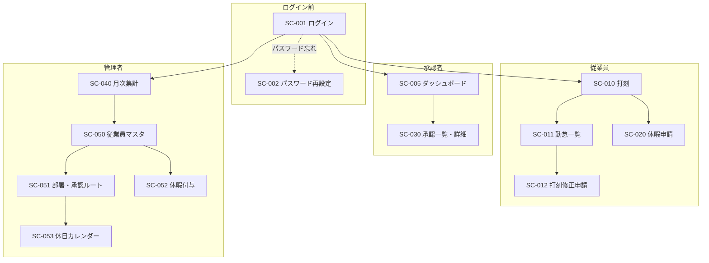
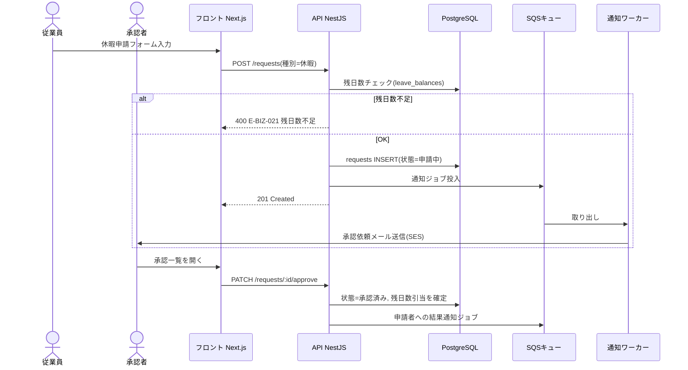

# 基本設計書(抜粋) — KintaiOne

| 項目 | 内容 |
|---|---|
| ドキュメントID | BD-001 |
| インプット | 要件定義書 REQ-001 v1.0(承認済み) |
| バージョン / ステータス | 1.0 / 承認済み |

※本ファイルはサンプルのため、テンプレート全セクションのうち代表的な部分のみ抜粋。

## 2.1 トレーサビリティマトリクス

| 機能ID | 機能名 | 画面ID | API ID | 主要テーブル |
|---|---|---|---|---|
| F-001 | 認証 | SC-001, SC-002 | API-001〜003 | users |
| F-002 | 打刻 | SC-010 | API-010, API-011 | time_records |
| F-003 | 勤怠閲覧 | SC-011 | API-012 | time_records |
| F-004 | 打刻修正申請 | SC-012 | API-013, API-014 | requests, time_records |
| F-005 | 休暇申請 | SC-020 | API-020, API-021 | requests, leave_balances |
| F-006 | 申請承認 | SC-030 | API-030, API-031 | requests, approval_routes |
| F-007 | 月次集計CSV | SC-040 | API-040, API-041 | time_records, monthly_summaries |
| F-008 | マスタ管理 | SC-050, SC-051 | API-050〜055 | users, departments, approval_routes |
| F-009 | 休暇付与管理 | SC-052 | API-056, API-057 | leave_grants, leave_balances |
| F-010 | メール通知 | -(画面なし) | -(非同期処理) | notifications |
| F-011 | ダッシュボード | SC-005 | API-005 | requests, time_records |
| F-013 | 休日カレンダー | SC-053 | API-058 | company_holidays |

✅ 全機能IDが画面またはAPIに紐づくことを確認済み(F-012 監査ログはCOULDのため今回未設計と明記)。

## 3.2 画面遷移図

※ロールにより初期遷移先とメニュー表示を切替(従業員→SC-010、承認者→SC-005、管理者→SC-040)。

## 5.1 シーケンス図(UC-02: 休暇申請〜承認)

## 6.1 権限マトリクス(抜粋)

| 操作 | 従業員 | 承認者 | 管理者 |
|---|---|---|---|
| 自分の打刻・申請 | ○ | ○ | ○ |
| 部下の申請の承認 | × | ○(自ルートのみ) | × |
| 全従業員の勤怠閲覧 | × | △(自部署のみ) | ○ |
| マスタ管理・CSV出力 | × | × | ○ |
| 他テナントのデータ | × | × | ×(システム的に分離) |

## 6.2 エラーコード体系

- 形式: `E-{分類}-{連番}` 分類: VAL(入力) / AUTH(認証認可) / BIZ(業務ルール) / SYS(システム)
- 例: `E-BIZ-021` 休暇残日数不足、`E-BIZ-010` 二重打刻

## 6.4 共通ルール

- 日時: DBはUTC(timestamptz)、表示はテナントのタイムゾーン(初期リリースはJST固定)
- ID: bigint identity(外部公開IDのみ別途ULID)
- マルチテナント分離: 全テーブルに company_id を持ち、API層で必ずテナント条件を付与(共通ガードで強制)
