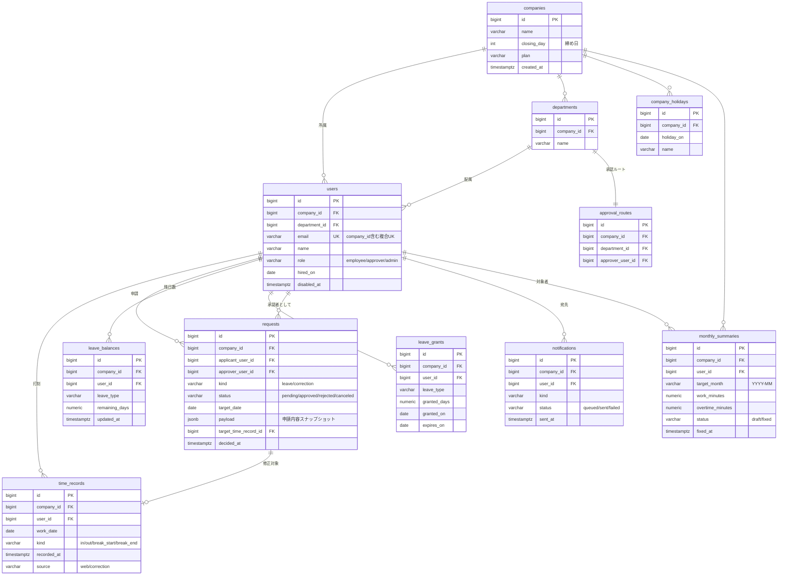

# DB設計書・ER図 — KintaiOne

| 項目 | 内容 |
|---|---|
| ドキュメントID | DB-001 |
| インプット | REQ-001 v1.0 / BD-001 v1.0 |
| RDBMS | PostgreSQL 16(RDS) |
| バージョン / ステータス | 1.0 / 承認済み |

## 1. 設計標準

テンプレート `templates/06` の標準に準拠。追加ルール:
- **全テーブル(companiesを除く)に `company_id` を持たせ、テナント分離を行単位で保証する**
- 複合ユニーク制約は必ず `company_id` を含める

## 2. ER図



## 3. テーブル定義(抜粋: time_records)

- **分類**: トランザクション
- **概要**: 打刻の生データ。修正申請の承認時も元レコードは更新せず、修正レコードを追加(source=correction)
- **想定件数**: 初期 0 → 1年後 約120万件

| カラム名 | 論理名 | 型 | NULL | デフォルト | 制約・説明 |
|---|---|---|---|---|---|
| id | ID | bigint | NO | identity | PK |
| company_id | 企業ID | bigint | NO | | FK→companies |
| user_id | 従業員ID | bigint | NO | | FK→users |
| work_date | 勤務日 | date | NO | | 締め処理の基準日 |
| kind | 打刻種別 | varchar(16) | NO | | CHECK(in/out/break_start/break_end) |
| recorded_at | 打刻時刻 | timestamptz | NO | | サーバ時刻 |
| source | 記録元 | varchar(16) | NO | 'web' | CHECK(web/correction) |
| superseded_by | 置換先ID | bigint | YES | NULL | 修正で無効化された場合の新レコードID |
| created_at / updated_at | | timestamptz | NO | now() | |

**インデックス**

| インデックス名 | カラム | 種別 | 用途 |
|---|---|---|---|
| idx_tr_user_date | company_id, user_id, work_date | btree | SC-011 勤怠一覧、月次集計 |
| idx_tr_company_date | company_id, work_date | btree | SC-005 当日出勤状況、API-040 集計 |

## 4. 主要クエリ検証(抜粋)

### SC-011 月次勤怠一覧(従業員1人×1ヶ月)

```sql
SELECT work_date, kind, recorded_at
FROM time_records
WHERE company_id = $1 AND user_id = $2
  AND work_date BETWEEN $3 AND $4
  AND superseded_by IS NULL
ORDER BY work_date, recorded_at;
```

- 使用インデックス: idx_tr_user_date(前方一致で有効)
- 想定行数: 最大 31日×最大6打刻 ≒ 200行以下 → 問題なし
- 月次集計(API-040)は全従業員分をユーザー単位でまとめて取得し、アプリ側でN+1を発生させない

## 5. データ移行

初期リリースは新規導入のみ。既存Excelからの従業員マスタ取込は管理画面のCSVインポート(F-008)で対応。

## 6. DDL(抜粋)

```sql
CREATE TABLE time_records (
    id bigint GENERATED ALWAYS AS IDENTITY PRIMARY KEY,
    company_id bigint NOT NULL REFERENCES companies(id),
    user_id bigint NOT NULL REFERENCES users(id),
    work_date date NOT NULL,
    kind varchar(16) NOT NULL CHECK (kind IN ('in','out','break_start','break_end')),
    recorded_at timestamptz NOT NULL,
    source varchar(16) NOT NULL DEFAULT 'web' CHECK (source IN ('web','correction')),
    superseded_by bigint REFERENCES time_records(id),
    created_at timestamptz NOT NULL DEFAULT now(),
    updated_at timestamptz NOT NULL DEFAULT now()
);
CREATE INDEX idx_tr_user_date ON time_records (company_id, user_id, work_date);
CREATE INDEX idx_tr_company_date ON time_records (company_id, work_date);
```

フルDDLは `ddl.sql`(実プロジェクトでは全テーブル分を生成し、CIでpsqlに流して構文検証する)。

## 7. 未確定事項

| # | 内容 | 決定者 | 期限 | ステータス |
|---|---|---|---|---|
| 1 | leave_balances を都度計算(grants−使用)にするか実体テーブルにするか | 田中 | 2026-08-25 | 決定済み: 実体+夜間整合バッチ |
