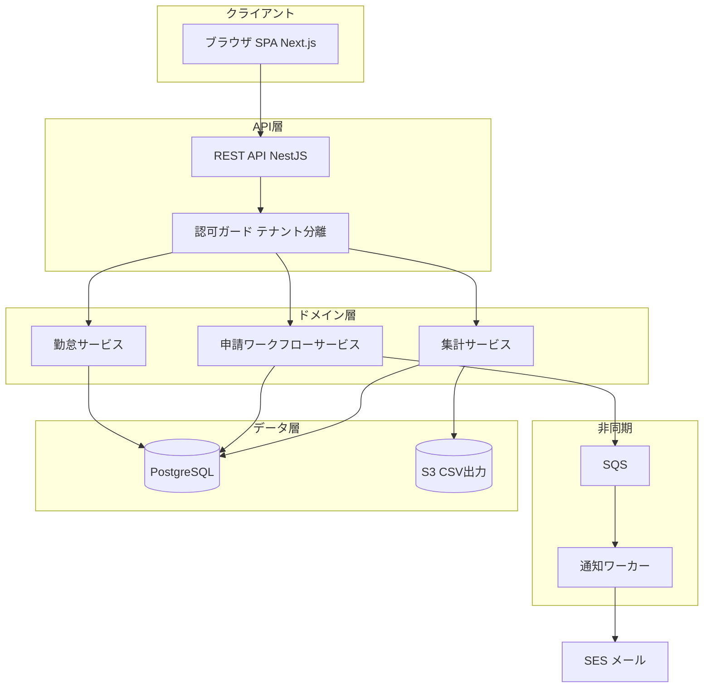
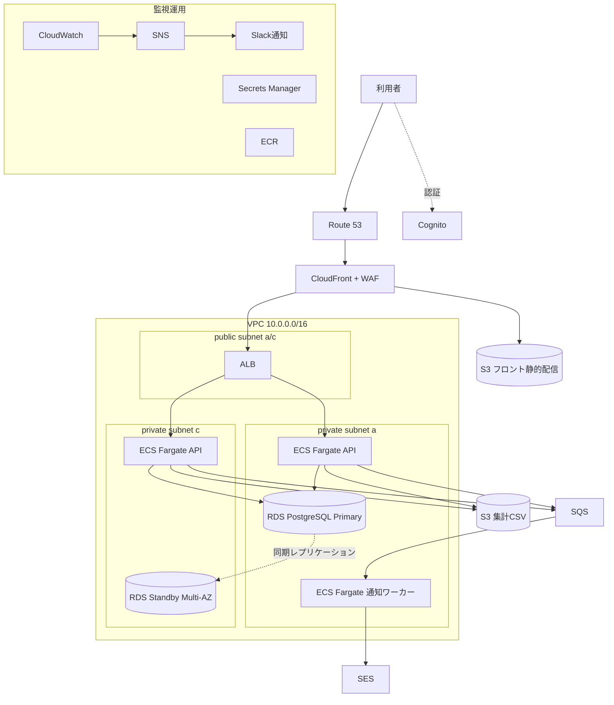
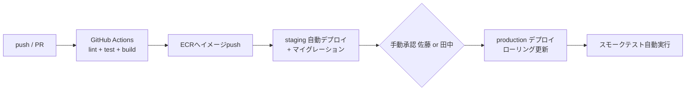

# アーキテクチャ設計書 — KintaiOne

| 項目 | 内容 |
|---|---|
| ドキュメントID | ARC-001 |
| インプット | REQ-001 v1.0 / NFR-001 v1.0 |
| バージョン / ステータス | 1.0 / 承認済み |

## 1. アーキテクチャ方針

開発・運用とも3名のため、**運用負荷最小**を第一評価軸とする。
モノリシックなAPI(NestJS)+SPA(Next.js静的出力)の構成とし、マイクロサービス化は行わない。
インフラは全てマネージドサービスで構成し、IaC(Terraform)で管理する。
マルチテナントはDB行レベル分離(company_id)+アプリ層ガードで実現する(テナント別DBは運用負荷から不採用)。

## 2. 技術選定(ADR抜粋)

### ADR-001: アプリ実行基盤

- **ステータス**: 承認済み
- **決定**: ECS Fargate

| 選択肢 | メリット | デメリット | 月額目安(本番) |
|---|---|---|---|
| ECS Fargate | サーバ管理不要、コンテナで開発と同一環境、スケール容易 | Lambdaより固定費が高い | $70〜 |
| Lambda + API Gateway | アイドルコストほぼゼロ | コールドスタート、NestJSとの相性、実行時間制限 | $20〜 |
| EC2 | 自由度最高 | OS運用が3人チームに重い | $60〜 |

- **決定理由**: 常時アクセスがある業務システムでコールドスタートは体験を損なう。
  チームにコンテナ経験があり、Fargateなら OS 運用ゼロ。
- **トレードオフ**: 深夜のアイドルコストは許容(Savings Planで軽減)。

### ADR-002: 認証

- **決定**: Amazon Cognito(自前実装は工数とセキュリティリスクから不採用。
  メール+パスワード、パスワードポリシー、再設定フローを標準機能で賄う)

### ADR-003: 非同期通知

- **決定**: SQS + ECSワーカー + SES(メール送信のリトライ・流量制御をアプリから分離)

## 3. 論理アーキテクチャ

## 4. インフラ構成図(AWS)

### 4.1 環境一覧

| 環境 | 用途 | 構成差分 | AWSアカウント |
|---|---|---|---|
| production | 本番 | RDS Multi-AZ、API 2タスク | prod用アカウント |
| staging | 検証・受入 | Single-AZ、最小サイズ、夜間停止 | stg用アカウント |
| development | 開発 | Docker Compose(RDS等は使わない) | - |

## 5. 非機能要件の実現方式(抜粋)

| 非機能要件 | 実現方式 |
|---|---|
| 稼働率99.5%(平日6-22時) | Multi-AZ、ECS 2タスク、ALBヘルスチェック |
| RPO 24h / RTO 4h | RDS自動スナップショット(日次)+PITR、復旧手順書とリストア演習(半期) |
| API 95%tile 500ms | インデックス設計(DB-001 §4)、集計はmonthly_summariesに事前計算 |
| テナント間分離 | 全クエリにcompany_idガード(共通ミドルウェアで強制+結合テスト) |
| 個人情報保護 | 保存時暗号化(RDS/S3)、TLS1.2+、Secrets Manager、最小権限IAM |
| 監査 | CloudTrail + アプリ監査ログ(F-012はPhase2だが記録だけは初期から行う) |

### 5.1 監視・アラート一覧(抜粋)

| 監視対象 | メトリクス | 閾値 | 通知先 |
|---|---|---|---|
| ALB | 5xx率 | 1%超が5分継続 | Slack #kintai-alerts |
| ECS | CPU/メモリ | 80%超10分 | Slack |
| RDS | 空きストレージ | 20%未満 | Slack |
| SQS | 滞留メッセージ数 | 100超 | Slack |
| 外形監視 | /health | 2回連続失敗 | Slack + 電話(Sev1扱い) |

## 6. CI/CD・リリース設計

- ブランチ戦略: GitHub Flow。mainマージでstaging自動デプロイ
- DBマイグレーション: Prisma Migrate。後方互換のある変更のみ(カラム削除は2リリースに分割)
- ロールバック: 直前のECRイメージタグに切り戻し(手順書 OPS-001 §2)

## 7. コスト概算(2026-08-10時点・概算)

| リソース | 構成 | 月額(USD) |
|---|---|---|
| ECS Fargate | API 2タスク(0.5vCPU/1GB)+ワーカー1 | 約 $80 |
| RDS PostgreSQL | db.t4g.medium Multi-AZ + 100GB | 約 $150 |
| ALB / CloudFront / Route53 | | 約 $45 |
| S3 / SQS / SES / ECR | | 約 $15 |
| CloudWatch / Secrets / WAF | | 約 $40 |
| **本番合計** | | **約 $330** |
| staging(夜間停止・最小構成) | | 約 $90 |
| **総合計** | | **約 $420(予算$500内)** |

※為替・料金改定の影響を受けるため、AWS Pricing Calculator での再見積りを四半期ごとに実施。

## 8. 未確定事項

| # | 内容 | 決定者 | 期限 | ステータス |
|---|---|---|---|---|
| 1 | WAFのマネージドルールセットの選定 | 田中 | 2026-09-10 | 検討中 |
