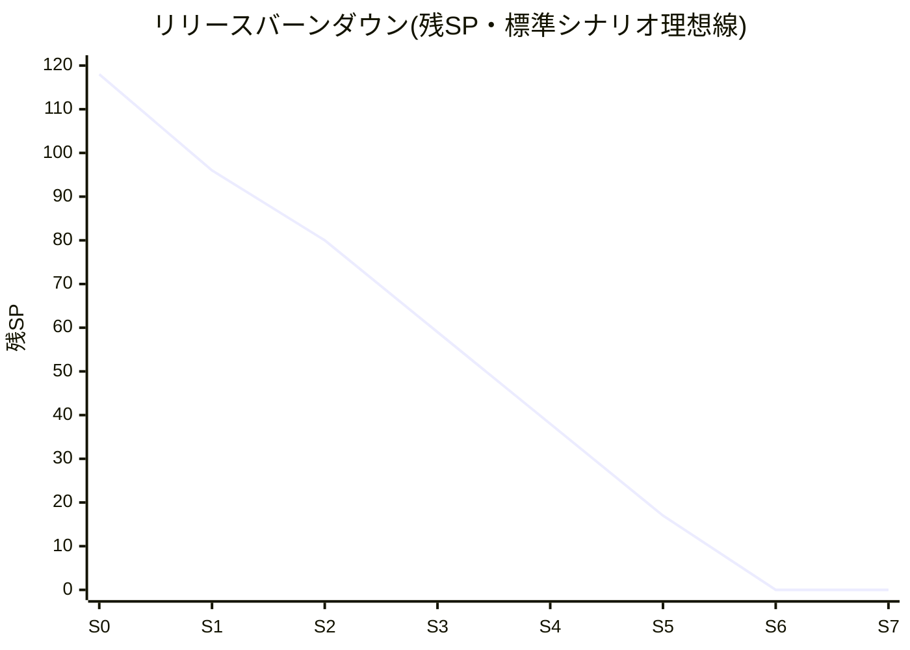

# リリース計画書(納期予測) — KintaiOne

| 項目 | 内容 |
|---|---|
| ドキュメントID | RP-001 |
| インプット | PBL-001(総SP 118、ポーカー済み) |
| 予測実施日 | 2026-08-21(Sprint 0 末) |
| ステータス | 承認済み(Sprint 3 末に第2回更新予定) |

## 1. 前提条件

| 項目 | 値 |
|---|---|
| チーム | 3名 × 稼働率ほぼ100%(佐藤のみ顧客対応で90%) |
| スプリント長 | 2週間(営業日10日) |
| Sprint 1 開始日 | 2026-08-24(Sprint 0: 8/10〜8/21 で設計・基盤着手済み) |
| 総SP(残SP) | 118(うちSprint 0 でUS-101, US-104消化済み → 残112) |
| 希望納期 | 2026-12-20 |
| 除外期間 | 9月シルバーウィーク、11/23、12月後半の顧客繁忙 |

## 2. ベロシティ

### 2.1 初期仮説の計算(実績が3スプリント貯まるまで使用)

```
スプリントあたり総工数 = 3人 × 10営業日 × 平均稼働0.97 ≒ 29人日
フォーカスファクター   = 0.6(スクラムイベント・レビュー・割込みを考慮)
実効人日              = 29 × 0.6 ≒ 17.4人日
SP↔人日レート         = 基準ストーリー US-201(3SP)≒ 2.5人日 → 1SP ≒ 0.83人日
仮ベロシティ(標準)    = 17.4 ÷ 0.83 ≒ 21SP
幅 ±30%              → 悲観 15 / 標準 21 / 楽観 27
Sprint 1〜2 立ち上げ補正 ×0.75 → 悲観 11 / 標準 16 / 楽観 20
```

### 2.2 実績(毎スプリント末に追記)

| スプリント | 計画SP | 完了SP | 持ち越し | 備考 |
|---|---|---|---|---|
| Sprint 1 | (16) | | | |

## 3. 納期予測(3点予測)— 残112SP

| シナリオ | 計算(S1-2補正後→通常V) | 必要スプリント | 完了予定日 |
|---|---|---|---|
| 楽観 | 20+20+27… | 5 | 2026-10-30 |
| **標準** | 16+16+21… | **7** | **2026-11-27** |
| 悲観 | 11+11+15… | 9 | 2026-12-25 ⚠️希望納期超過 |

- **対外提示日**: 12月上旬リリース見込み(標準11/27+ハードニング考慮)。「11月末確定」とは言わない
- **MUSTのみの最小リリース**(残89SP): 悲観でも 7スプリント → **2026-11-27** ✅
- ⚠️ **悲観シナリオはフルスコープで希望納期を超過する。** 対応方針(承認済み):
  Sprint 3 末の実績更新時点で悲観側に振れていた場合、SHOULD群(E-05 ダッシュボード、
  F-009 付与自動化、F-013 休日カレンダー=計23SP)を第2リリース(1月)へ後ろ倒しする。
  この判断を12月に持ち越さないことがポイント。

## 4. スプリント割当て案

| スプリント | 期間 | ゴール(1文) | 主なストーリー | SP |
|---|---|---|---|---|
| Sprint 0 | 8/10-8/21 | 設計承認と開発の土台(済) | 設計一式, US-101, US-104 | 6 |
| Sprint 1 | 8/24-9/4 | ログインして打刻できる | US-102, US-103, US-201 | 16 |
| Sprint 2 | 9/7-9/18 | 勤怠が見え、打刻を直せる | US-202, US-203, US-204, US-105 | 16 |
| Sprint 3 | 9/23-10/6 | 休暇の申請〜承認が一巡する ★実績で予測更新 | US-301, US-302, 通知基盤 | 21 |
| Sprint 4 | 10/7-10/20 | マスタを顧客が自分で整備できる | E-04群 | 21 |
| Sprint 5 | 10/21-11/4 | 月次集計とCSVが出る(最難関) | US-501他 E-03群 | 21 |
| Sprint 6 | 11/5-11/18 | SHOULD群+予備 | E-05群, F-009 | 21 |
| Sprint 7 | 11/19-11/27 | ハードニング(バグ・性能・リリース準備) | - | V×0.5計上 |

※リスク高(US-103, US-501)は前半〜中盤に配置。シルバーウィークはSprint 3の期間を調整済み。

## 5. リリースバーンダウン



毎スプリント末に実績線を追記し、理想線との乖離が2スプリント連続したら §6 により再計画。

## 6. 再計画のトリガー

- 実績ベロシティが仮説から±30%以上乖離が2スプリント連続 → 全予測を実績値で引き直し
- バックログ追加が累計20SP超(変更管理ルール経由のみ受付)
- Sprint 3 末の定期更新(初回の実績3点が揃うタイミング)
- 悲観シナリオでも12/20に収まらなくなった時点 → **その日のうちに**スコープ判断を実施

## 7. リスクと対応

| # | リスク | 影響 | 対策 |
|---|---|---|---|
| 1 | Cognitoカスタム属性の制約が発覚(US-103) | +3〜5SP | Sprint 1 で最優先着手。ダメなら自前JWTのADR再検討 |
| 2 | 締め日ロジックの仕様沼(US-501) | +5SP | 課題#2(締め日変更の扱い)を9/1までに決定(決定者: 佐藤) |
| 3 | 12月の顧客繁忙で受入テストが遅延 | +1スプリント | 受入は11月中に前倒し(Sprint 6 レビューで実施) |
