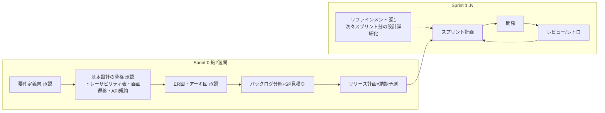

# スクラム運用ガイド — 3人チーム × AI で回すスクラム

`運用ガイド.md`(ドキュメントレビューの基本ルール)の上に載せる、スクラム特化の運用です。
前提: 2週間スプリント、ストーリーポイント+ベロシティ、GitHub Issues/Projects。

## 1. 上流工程とスクラムの関係(いつ設計するのか)

「全部設計してから開発」ではなく、**Sprint 0 で骨格を承認し、詳細はリファインメントで先行詳細化**します。
ただし今回の失敗(ストーリーだけで実装開始)を繰り返さないため、骨格の最低ラインを固定します。

**Sprint 0 の完了条件(=実装開始ゲートのスクラム版)**

- [ ] 要件定義書・ER図・アーキテクチャ図が承認済み
- [ ] 基本設計は「骨格」(トレーサビリティ表・画面遷移図・API共通規約・共通設計)まで承認済み。
      画面・API詳細はストーリー単位で【リファインメントで詳細化】と明記されている
- [ ] 全ストーリーにSP(チームポーカー済み)と受入条件がある
- [ ] リリース計画書に3点予測の納期と再計画トリガーがある
- [ ] DoR/DoD にチームが合意した

## 2. スクラムイベント × AI の分担表

| イベント | いつ | 人間がやること | AIにやらせること(→スキル/プロンプト) |
|---|---|---|---|
| スプリント計画 | 隔週月曜 2h | ゴール合意、SP最終判断、担当決め | キャパ計算、候補選定、タスク分解案(sprint-ops / 09) |
| デイリー | 毎日 15分 | 会話・ブロッカー解消 | Issues/PRからの状況サマリ事前生成(sprint-ops §5) |
| リファインメント | 毎週水曜 30分 | 優先順位判断、受入条件の妥当性 | 分割案、受入条件の書き直し、設計との不整合検出(sprint-ops §2) |
| スプリントレビュー | 隔週金曜 1h | デモ、PO受入判断 | レビュー資料・デモ手順・ステークホルダー向けサマリ(sprint-ops §3) |
| レトロ | 隔週金曜 45分 | Keep/Problemを出す、Try決定 | 実績データ整理、パターン分析、Try候補(sprint-ops §4) |
| (計画の更新) | 毎スプリント末 | 予測の受け止めと共有判断 | ベロシティ更新→納期3点予測の再計算(release-planning / 08) |

**原則: 見積り・優先順位・受入の「最終決定」は必ず人間。AIは叩き台と計算を担当。**

## 3. 納期の答え方(ステークホルダー対応)

- 聞かれたら常に**幅**で答える: 「標準シナリオで12/6、悲観で12/20。3スプリント後には幅が半分になります」
- 対外的に1つの日付を求められたら `forecast.py --simulate` の **P85**(85%の確率で守れる日)を使う。
  P50(五分五分)を約束すると2回に1回破ることになる
- 毎スプリント末に `forecast.py --accuracy` で計画の過大/過小バイアスを確認し、
  達成率85%未満が続いたら「計画SPをキャパ×達成率に補正」をレトロで即決する
- 実績ベロシティが3スプリント貯まるまでは「仮説値」と必ず添える
- 予測が悪化したら**その日のうちに**共有する。改善してから報告しようとしない
- 対外コミットは悲観寄り、チーム内目標は標準、で使い分ける

## 4. 変更管理(スクラム版) — タスク膨張の防止

新しい要望・仕様変更が来たら:

1. **その場でバックログ末尾に起票**(実装しない・約束しない)。`type:未トリアージ` ラベル
2. 週次リファインメントでAIに影響分析させる(SP見積り+既存ストーリーとの重複・矛盾)
3. POが優先順位を決める。**割り込ませる場合は、同SP分のストーリーをライン外に押し出す**
   (バックログは風呂桶。入れたら溢れる。溢れた分をどれにするか決めるのがPOの仕事)
4. リリース計画書の消化可能SPラインを引き直し、納期が動くなら §3 のルールで即共有
5. **スプリント中のスコープ変更は原則禁止。** 緊急対応は「割込み枠」で吸収し、レトロで件数を振り返る

## 5. GitHub Issues / Projects の運用規約

- 1ストーリー=1 Issue。受入条件は本文チェックリスト、タスクはスプリント計画時に追記
- ラベル: `epic:E-xx` / `sp:1|2|3|5|8|13` / `type:機能|基盤|スパイク|非機能` / `risk:high`
- マイルストーン = スプリント(`Sprint 1`)。Projects のステータスは
  `Backlog → Ready → In Progress → Review → Done`(Ready へ動かせるのはDoRを満たしたものだけ)
- PRは必ずIssueに `Closes #xx` でリンク。設計書を変えたPRは本文に該当セクションを記載
- ベロシティ集計: スプリント末に `Done` かつ受入済みのIssueの `sp:` ラベル合計。
  未完了は部分計上しない(0か満額)

## 6. スクラムのアンチパターン(3人チームで起きがちなもの)

| アンチパターン | 何が起きるか | 対策 |
|---|---|---|
| SPを人日に固定換算して詰め込む | 見積りが約束になり、ベロシティが操作される | SPは相対値のまま。人日換算は対外説明のみ |
| ベロシティを「上げる」目標にする | SPインフレで予測が壊れる | ベロシティは観測値。目標はスプリントゴール |
| 受入条件なしでスプリントに入れる | 実装中に仕様議論が始まり膨張(今回の再演) | DoRで機械的にブロック |
| 持ち越しの常態化 | 予測不能になり計画が形骸化 | 計画SPをキャパの90%に抑える。3連続持ち越しでレトロの最優先議題 |
| レビューを身内デモで済ませる | 実ユーザーの声が入らず後半で手戻り | 隔週レビューに最低1人、開発外の人を呼ぶ |
| Sprint 0 が伸び続ける | 「設計が終わらない」で開発が始まらない | Sprint 0 は最大2週間。骨格承認+詳細は並走、と割り切る |
