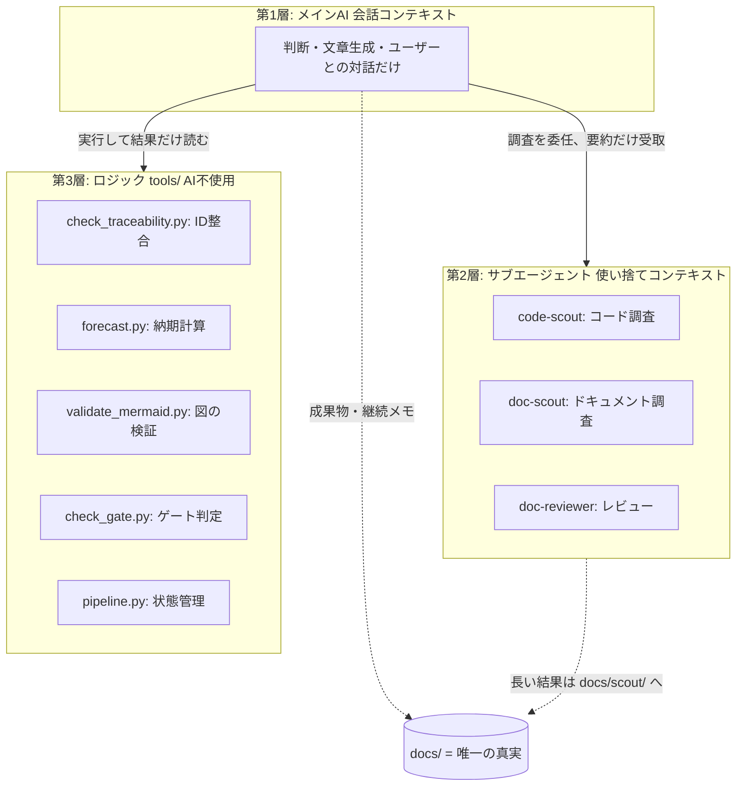

# 自動化・リトライ設計ガイド — AIを信用しすぎない作りにする

「コンテキストが溢れて止まる」「同じ検査を毎回AIにやらせて揺れる」への対策として、
このキットは**3層構造**になっています。層が下がるほど決定論的(=止まらない・揺れない)です。

## 各層に何を置くか(判断基準)

| 仕事 | 層 | 理由 |
|---|---|---|
| 要件の言語化、設計判断、優先度提案 | 第1層(メインAI) | 人間との対話と文脈が必要 |
| コード・ドキュメントの読み込み調査 | 第2層(サブエージェント) | 大量読み込みはコンテキストを食うだけ |
| レビュー(指摘出し) | 第2層 | 全文読みが必要だが結果は表だけでよい |
| ID対応表の突き合わせ | **第3層(スクリプト)** | 機械的な集合演算。AIにやらせると見落とす・揺れる |
| 納期・ベロシティ計算 | **第3層** | 算数。AIの暗算は信用しない |
| Mermaid構文チェック | **第3層** | パーサーが正解を知っている |
| ゲート判定(承認済みか等) | **第3層** | チェックリストの機械照合 |
| 工程の進行状態の記録 | **第3層** | セッションが死んでも残る場所に置く |

**原則: 「正解が機械的に決まるものはAIにやらせない」。**
AIには判定結果の解釈と修正だけをさせます。これでコンテキスト消費が減るだけでなく、
「AIが検査したつもりで見落とす」事故も消えます。

## 止まったときの復帰(リトライ)設計

### 仕組み

1. **状態ファイル** `docs/.state/pipeline.json` — どの工程がどこまで進んだかを
   `pipeline.py start/step/done` で記録。会話が死んでも残る
2. **継続メモ** `docs/wip/<工程>_継続メモ.md` — 各スキルが主要Stepごとに上書きする
   「済みStep / 確定事項 / 未解決の論点 / 次の1手」の4項目(各3行以内)
3. **成果物は常にdocs/に保存済み** — チャットにしか無い情報を作らない

この3つで「会話コンテキスト=いつ消えてもよいキャッシュ」になります。

### 復帰手順(ユーザーがやること)

| 状況 | やること |
|---|---|
| コンテキスト警告が出た / 応答が重い | 新しいセッションを開いて `/resume` |
| セッションが落ちた・止まった | 新しいセッションで `/resume` |
| どこまで進んだか分からなくなった | `python3 tools/pipeline.py status`(AI不要。ターミナルで直接見られる) |
| 状態ファイルと実ファイルが食い違う | `/resume` が doc-scout で棚卸しして状態を復元する |
| 生成物が壊れている(表が途切れた等) | `/check` でNG箇所を特定 → 該当§だけ再生成を指示 |

`/resume` は「継続メモだけを読み、済みStepをスキップして続きから」が仕様です。
**「最初からやり直します」と言い出したら拒否してください**(禁止事項として書いてあります)。

### 自動リトライ(/checkの3周ルール)

機械チェックNG時の修正は「修正 → スクリプト再実行 → OKまで」を最大3周AIに回させます。
3周で直らないものは人間の判断が必要な問題(仕様の矛盾など)である可能性が高いので、
仮説と選択肢を出させて止める設計です(無限に回して溶かさない)。

## 第4の強制力: hooks(お願いではなく保証)

CLAUDE.mdやスキルの指示は「助言」なので、AIが従い忘れる余地があります。
hooksは**必ず実行される**ため、重要なチェックはhooksに昇格させます。
設定例は `hooks/settings.example.json`(プロジェクトの `.claude/settings.json` にマージ):

- **SessionStart**: セッション開始時に `pipeline.py status` を自動表示 →
  `/resume` を打ち忘れても進行中の工程に気づける
- **PostToolUse(Write|Edit)**: docs/ 配下のMarkdownを編集した瞬間に
  `tools/hook_docs_check.py` が整合チェックを実行。NGなら要約がAIに直接返り、
  その場で修正させる(「チェックし忘れ」が構造的に不可能になる)
- **Stop(任意)**: ゲート未通過のままターンを終了できなくする強制版。
  作業途中のNGも弾いてしまうため、既定ではコメントアウト

## CI: 人もAIも信用しない最後の砦

`ci/` にGitHub Actionsの例を同梱しています(`.github/workflows/` にコピー):

- **docs-checks.yml** — docs/を変更するPRごとにトレーサビリティ+Mermaid検証を実行。
  「ドキュメントを壊すPR」はAI関与ゼロでマージ前に弾かれる
- **nightly-drift.yml** — 毎晩、Claude Codeのヘッドレスモード(`claude -p`)で
  「設計書と実装の乖離」を調査し、乖離があれば自動でIssue起票。
  ドキュメントの形骸化(今回の失敗の再発形態として最も多い)を毎日検知する。
  トークンコストがかかるため、まず週1から始めるのも可

## レビューの独立性(Writer/Reviewer分離)

「作った本人に採点させない」ため、レビューは常に新鮮なコンテキストで行います。
`/docreview` はdoc-reviewerサブエージェント(独立コンテキスト)で実行されるのでこれを満たしますが、
重要ドキュメントの最終承認前は、さらに**別セッション**(または別メンバのアカウント)で
`/docreview` を実行するのが最も堅い運用です。生成に使った会話の中でのレビューは、
自己弁護バイアスがかかるため承認判定には使わないでください。
