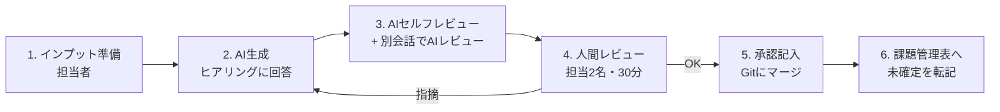

# 運用ガイド — 3人チームでAIに上流工程をさせる回し方

このガイドは「AIがドキュメントを書き、人間が判断・承認する」体制を3人チームで回すための実務ルールです。

## 1. 役割分担

AIは**起案者**であり、**決定者にはなれない**。人間の役割は「書く」から「判断する」に変わります。

| 役割 | 担当(例) | やること |
|---|---|---|
| プロダクトオーナー役(PO) | メンバA | 要件の決定、優先度(MUST/SHOULD)の最終判断、スコープ外の承認 |
| アーキテクト役 | メンバB | 技術選定ADRの承認、DB設計・アーキテクチャ図の承認 |
| 品質・進行役 | メンバC | トレーサビリティ表の整合チェック、課題管理表の番人、WBS更新 |

※3人とも開発者で兼務。「役割」はレビュー時の責任分担であり、専任ではない。
※自分が主導してAIに書かせたドキュメントの承認者には、必ず**別の人**がなる(自己承認禁止)。

## 2. 基本サイクル(1ドキュメントあたり)



- **1ドキュメント1〜2営業日**を目安にする(AI生成は数十分、律速は人間レビュー)
- 手順3の「別会話でAIレビュー」は `prompts/05_レビュープロンプト.md` を使う。
  作成に使った会話でそのままレビューさせない(自己弁護バイアスがかかる)
- 手順4のレビューは**同期(通話/対面)30分**で行う。非同期コメントだけだと1週間漂流する

## 3. 人間レビューで見るべきこと(AIレビューとの分担)

機械的なチェック(ID対応漏れ、空欄、矛盾)はAIレビューに任せる。人間は**AIには判断できないこと**に集中する:

- **それは本当にユーザーが欲しいものか**(業務の実態と合っているか)
- **優先度は正しいか**(MUSTは本当にMUSTか。削れるものはないか)
- **チームで作り切れるか**(自分たちのスキル・工数の現実と合っているか)
- **暗黙の前提**(社内政治、顧客の癖、過去の失敗など、AIが知らない文脈)

## 4. 週次の運用リズム

| 曜日 | 30分ミーティング | 内容 |
|---|---|---|
| 月 | 週次定例 | 課題管理表の期限切れ確認 → 未確定事項の決定(最優先議題) |
| 水 | レビュー会 | 今週生成したドキュメントの承認レビュー |
| 金 | 進捗確認 | WBS消化確認、変更要望のトリアージ(§5) |

## 5. 変更管理 — タスク膨張を二度と起こさないために

**新しい要望・仕様変更が出たときのルール(全員厳守):**

1. どんなに小さくても、**まず課題管理表に起票**する。「ついでに実装」は禁止
2. AIに影響分析をさせる(「この変更で修正が必要なドキュメント・コード・工数を洗い出して」)
3. 金曜の進捗確認で三択を決める: **納期をずらす / 他の機能を削る / 次リリースに回す**
   (「頑張って吸収する」は選択肢にない)
4. 決定したら**先にドキュメントを改訂**(変更PR)し、承認後に実装する

## 6. ドキュメントのGit運用

```
docs/
├── 01_要件定義書.md          ← 承認済みが main にある状態を保つ
├── ...
└── issues/課題管理表.md
```

- ドキュメント変更は必ずPR経由。承認役がPRをApproveしたら「承認」とみなす
- コミットメッセージ例: `docs(req): F-012 の優先度を SHOULD に変更(課題#5 の決定)`
- 実装PRの説明欄には対応する機能ID(F-xxx)と設計書のセクションを必ずリンクする
- Mermaid図はGitHub/GitLab上でそのままレンダリングされるので、図の修正も差分レビューできる

## 7. AIに渡すインプットの管理

- プロジェクト直下に `.claude/skills/` としてこのキットのスキルを配置する
- `CLAUDE.md`(またはプロジェクトのAI設定ファイル)に以下を書いておくと毎回の指示が不要になる:

```markdown
# プロジェクト前提
- ドキュメントは docs/ 配下、Markdown + Mermaid
- 技術スタック: 【記入】
- 設計標準は docs/06_DB設計書_ER図.md §1 に従う
- 新機能の相談を受けたら、まず docs/issues/課題管理表.md への起票を促すこと
- ドキュメントと矛盾する実装を求められたら、ドキュメント改訂を先に提案すること
```

## 8. アンチパターン(今回の失敗を繰り返さないために)

| アンチパターン | 何が起きるか | 対策 |
|---|---|---|
| ストーリーだけで実装開始 | 実装中に仕様判断が頻発しタスク膨張 | 実装開始ゲート(README)を通す |
| AI出力を読まずに承認 | 誤った設計が既成事実化 | レビュー会で音読レベルの確認、承認者の記名 |
| ドキュメントと実装の乖離を放置 | ドキュメントが信用されなくなり形骸化 | 実装PRに設計書リンク必須、乖離を見つけたら即課題起票 |
| 未確定のまま「仮実装」 | 手戻りが雪だるま式に | 未確定のMUST機能は実装着手禁止 |
| 全部AIに一気に生成させる | 誰も読まない大量ドキュメント | 承認ゲートごとに1工程ずつ進める |
