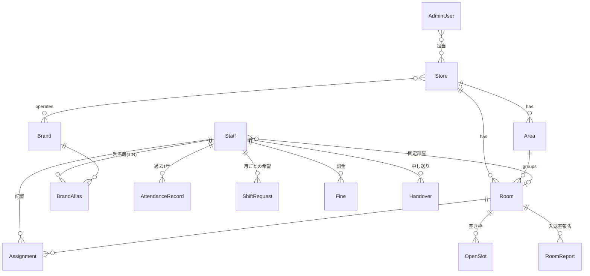

# シフト管理・部屋管理 モック — データモデルと画面一覧

実装前に合意するための設計メモ。型の正本は `lib/types.ts`。

## 1. データモデル



| エンティティ | 主な項目 | 補足 |
|---|---|---|
| Store | name, brandIds, settings | settings = 営業時間・刻み・提出期限日・入替インターバル・時間帯(早番等) |
| Area / Room | areaId, checklist[], photoSpots[] | 部屋ごとに備品/清掃チェック項目と撮影箇所×枚数 |
| Staff / BrandAlias | homeAreaId, fixedRoomId?, aliases[] | 1人が複数ブランドで別名義 |
| AdminUser | role(admin/owner), permissions[] | 権限は画面単位 |
| AttendanceRecord | date, status | present / late / absent(事前) / sameDayAbsent(当日) |
| ShiftRequest | month, entries[{date, bandId}], submittedAt | 期限後はロック |
| Assignment | roomId, staffId, start, end, status | status=draft が自動仮組みの仮配置 |
| OpenSlot | takenBy? | 早い者順。取得で他スタッフから消える |
| RoomReport | kind(enter/exit), photos[], checks{} | 写真はモックでは縮小 dataURL |
| Notice / Handover / Fine / FinePayment | | 罰金残金 = Σ罰金 − Σ支払 |
| ScoreItem / AlertSetting | weight / 閾値(スタッフ個別) | |
| OperationLog | at, actor, action, detail | 書き込み操作をすべて記録 |

## 2. 画面一覧・ルーティング

| パス | 画面 | 対象 |
|---|---|---|
| `/` | ログイン(3ボタン) | 全員 |
| `/staff` | ホーム(お知らせ・申し送り・罰金残金・次回シフト) | スタッフ |
| `/staff/requests` | シフト希望提出(月カレンダー×時間帯、期限カウントダウン) | スタッフ |
| `/staff/shifts` | 確定シフト / 空き枠タブ | スタッフ |
| `/staff/report` | 入退室報告(撮影テンプレート+チェックリスト) | スタッフ |
| `/staff/absence` | 急な休みの報告 | スタッフ |
| `/admin` | 配置ボード(初期画面)+自動仮組み | 管理者 |
| `/admin/staff` | スタッフ一覧(スコア・期間タブ・アラート) | 管理者 |
| `/admin/score` | スコア設定(比重スライダー) | 管理者 |
| `/admin/alerts` | アラート設定(個別閾値) | 管理者 |
| `/admin/rooms` | 部屋管理(エリア・部屋・チェック項目・撮影箇所) | 管理者 |
| `/admin/roster` | 名簿管理(別名義・CSV/Excel一括登録) | 管理者 |
| `/admin/requests` | シフト希望の集計(ヒートマップ・未提出者) | 管理者 |
| `/admin/reports` | 入退室報告の確認 | 管理者 |
| `/admin/notices` | お知らせ・申し送り・罰金 | 管理者 |
| `/admin/sheets` | スプレッドシート連携(プレビュー+CSV) | 管理者 |
| `/owner/admins` | 管理者アカウント・権限 | オーナー |
| `/owner/logs` | 操作履歴 | オーナー |
| `/owner/settings` | 店舗ごとの設定・セッションタイムアウト | オーナー |

オーナーは管理者画面もすべて使える。管理者は付与された画面だけサイドメニューに出る。

## 3. 層構成

```
app/            画面(すべてクライアント描画。データは localStorage)
components/     UI(shadcn/ui 互換) と画面部品
lib/types.ts    型
lib/autoAssign.ts / lib/score.ts / lib/stats.ts  純粋ロジック(単体テスト対象)
lib/repositories/  データアクセス層(interface + mock 実装) ← 本番で Firestore 実装に差し替え
lib/store.ts    Zustand + persist(localStorage)。mock 実装の保存先
mock/           シード固定のダミーデータ生成
```
