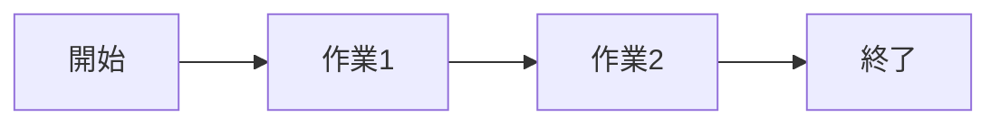
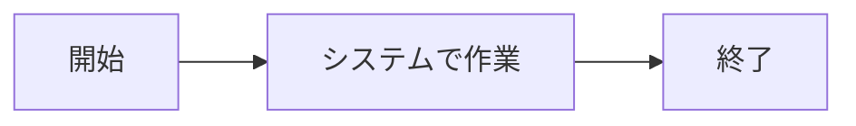

# 要件定義書

| 項目 | 内容 |
|---|---|
| ドキュメントID | REQ-001 |
| プロジェクト名 | 【記入】 |
| バージョン | 0.1 (ドラフト) |
| 作成者 | |
| レビュー担当 | |
| 承認者 / 承認日 | |
| ステータス | ドラフト / レビュー中 / 承認済み |

## 改訂履歴

| 版 | 日付 | 変更内容 | 変更者 |
|---|---|---|---|
| 0.1 | | 初版ドラフト | |

---

## 1. プロジェクトの背景と目的

<!-- なぜこのシステムを作るのか。現状の課題 → 解決後の姿 を2〜3段落で。 -->

### 1.1 解決したい課題

### 1.2 目的とゴール(KPI)

<!-- 測定可能な指標で。例: 「申請処理時間を平均30分→5分に短縮」 -->

| KPI | 現状 | 目標 | 測定方法 |
|---|---|---|---|
| | | | |

## 2. 利用者(ステークホルダー)

| ロール | 説明 | 想定人数 | 利用頻度 |
|---|---|---|---|
| 例: 一般ユーザー | | | |
| 例: 管理者 | | | |

## 3. スコープ

### 3.1 今回のリリースでやること

### 3.2 今回のリリースでやらないこと(スコープ外)

<!-- ★最重要セクション。最低5項目。「将来やるかもしれないが今回はやらない」ことを具体的に。 -->

| # | やらないこと | 理由 | 将来対応の可能性 |
|---|---|---|---|
| 1 | | | |

## 4. 業務フロー

<!-- 現行(As-Is)と導入後(To-Be)。Mermaidで描く。 -->

### 4.1 現行業務フロー(As-Is)

### 4.2 導入後業務フロー(To-Be)

## 5. 機能要件

### 5.1 機能一覧

<!-- 優先度: MUST(ないとリリース不可) / SHOULD(重要) / COULD(余裕があれば) / WON'T(今回やらない) -->

| 機能ID | 機能名 | 概要 | 対象ロール | 優先度 |
|---|---|---|---|---|
| F-001 | | | | MUST |
| F-002 | | | | SHOULD |

### 5.2 ユーザーストーリーと機能の対応表

<!-- ★全ストーリーが機能IDに紐づいていることを確認。紐づかないストーリー=スコープ漏れ。 -->

| ストーリーID | ユーザーストーリー | 対応機能ID |
|---|---|---|
| US-01 | 〜として、〜したい。なぜなら〜 | F-001 |

### 5.3 機能詳細

<!-- MUST機能はすべて記載。入力→処理→出力 の粒度で。 -->

#### F-001: 【機能名】
- **概要**:
- **入力**:
- **処理**:
- **出力**:
- **例外・制約**:

## 6. 外部インターフェース

| # | 連携先システム | 方向 | 内容 | 方式 |
|---|---|---|---|---|
| 1 | | 送信/受信 | | API / ファイル / その他 |

## 7. データ要件(概要)

<!-- 主要なデータと件数規模。詳細はDB設計書で。 -->

| データ | 初期件数 | 1年後想定 | 保持期間 |
|---|---|---|---|
| | | | |

## 8. 制約条件

- **納期**:
- **予算**:
- **体制**: (人数・スキル)
- **技術制約**: (指定言語、既存システム等)
- **法規制・コンプライアンス**: (個人情報保護法、業界規制等)

## 9. 前提条件・依存事項

<!-- 相手先の準備、外部サービスの契約など、こちらでコントロールできないもの -->

## 10. 用語集

| 用語 | 定義 |
|---|---|
| | |

## 11. 未確定事項・課題

<!-- 【未確定】項目はすべてここに集約し、課題管理表にも転記する。 -->

| # | 内容 | 決定者 | 期限 | ステータス |
|---|---|---|---|---|
| 1 | | | | 未着手 |
