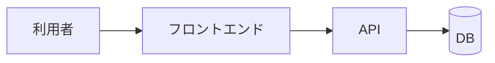
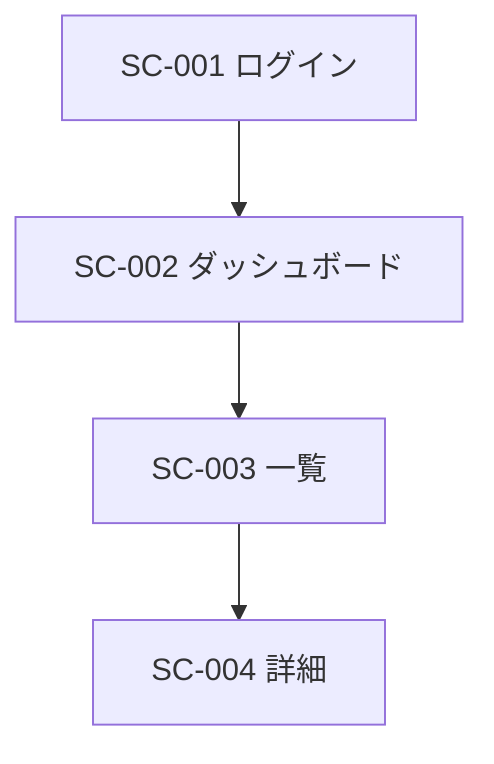
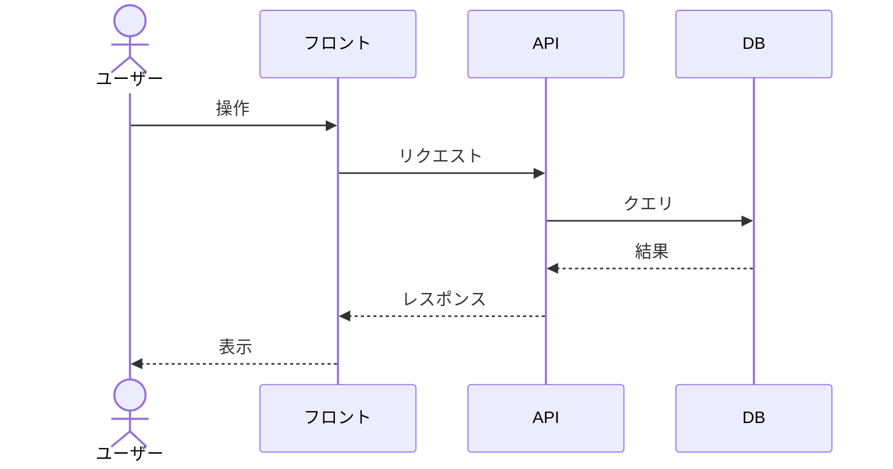

# 基本設計書

| 項目 | 内容 |
|---|---|
| ドキュメントID | BD-001 |
| プロジェクト名 | 【記入】 |
| バージョン | 0.1 (ドラフト) |
| インプット | 要件定義書 REQ-001 vX.X(承認済みであること) |
| 作成者 / レビュー担当 / 承認者 | |
| ステータス | ドラフト |

## 1. システム全体像

### 1.1 システム構成概要

<!-- 3〜5行の文章 + 俯瞰図。詳細はアーキテクチャ設計書へ。 -->

### 1.2 技術スタック

| レイヤ | 技術 | バージョン | 選定理由 |
|---|---|---|---|
| フロントエンド | | | |
| バックエンド | | | |
| DB | | | |

## 2. 機能設計

### 2.1 トレーサビリティマトリクス

<!-- ★このドキュメントの心臓部。機能→画面→API→テーブルの対応。空欄=設計漏れ。 -->

| 機能ID | 機能名 | 画面ID | API ID | 主要テーブル |
|---|---|---|---|---|
| F-001 | | SC-001 | API-001 | |

### 2.2 機能別処理概要

#### F-001: 【機能名】
- **トリガー**: (誰が・いつ・どこから)
- **処理フロー**: (箇条書き or シーケンス図)
- **異常系**: (エラー時の挙動)

## 3. 画面設計(概要)

<!-- 詳細は 04_画面設計書.md へ。ここでは一覧と遷移図のみ。 -->

### 3.1 画面一覧

| 画面ID | 画面名 | 対応機能ID | 利用ロール | 備考 |
|---|---|---|---|---|
| SC-001 | ログイン | F-001 | 全員 | |

### 3.2 画面遷移図

## 4. API設計(概要)

<!-- 詳細は 05_API仕様書.md へ。 -->

### 4.1 API一覧

| API ID | メソッド | パス | 概要 | 対応機能ID | 認可(呼べるロール) |
|---|---|---|---|---|---|
| API-001 | POST | /api/v1/auth/login | ログイン | F-001 | 全員 |

## 5. 処理方式設計

### 5.1 主要ユースケースのシーケンス図

#### UC-01: 【ユースケース名】

### 5.2 バッチ処理一覧

| バッチID | 名称 | 起動条件 | 処理概要 | 多重起動制御 | 失敗時のリラン |
|---|---|---|---|---|---|
| | | | | | |

### 5.3 外部連携

| 連携先 | 方式 | タイミング | 障害時の扱い(リトライ・整合性) |
|---|---|---|---|
| | | | |

### 5.4 通知・非同期処理

<!-- メール送信、プッシュ通知など。同期処理から切り離す方式(キュー等)を明記。 -->

## 6. 共通設計

### 6.1 認証・認可

- 認証方式:
- セッション/トークン管理:
- ロール×主要操作の権限マトリクス:

| 操作 | 一般 | 管理者 |
|---|---|---|
| | ○ | ○ |

### 6.2 エラーハンドリング

- エラーコード体系: (例: `E-{層}-{連番}`)
- ユーザーへの表示方針: (技術詳細を見せない、問い合わせ番号を出す等)

### 6.3 ログ設計

| 種類 | 出力内容 | レベル | 出力先 | 保持期間 |
|---|---|---|---|---|
| アクセスログ | | INFO | | |
| アプリログ | | INFO/WARN/ERROR | | |
| 監査ログ | 誰がいつ何を変更したか | INFO | | |

### 6.4 その他共通ルール

- 日時: (例: DB保存はUTC、表示はJST)
- ID採番: (例: 連番 / UUID v7)
- 文字コード: UTF-8

## 7. 未確定事項

| # | 内容 | 決定者 | 期限 |
|---|---|---|---|
| | | | |
