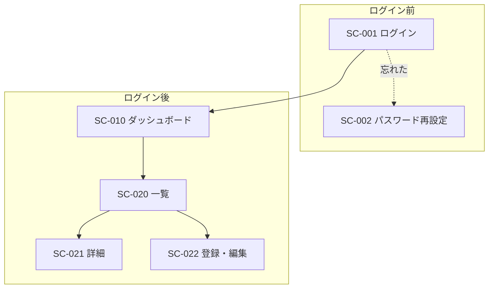

# 画面設計書

| 項目 | 内容 |
|---|---|
| ドキュメントID | UI-001 |
| インプット | 基本設計書 BD-001 |
| バージョン / ステータス | 0.1 ドラフト |

## 1. 共通UI仕様

### 1.1 レイアウト共通ルール

- 画面の基本構成: (ヘッダ / サイドメニュー / コンテンツ / フッタ)
- レスポンシブ対応: (ブレークポイント、スマホでの挙動)

### 1.2 共通コンポーネント

| コンポーネント | 仕様 |
|---|---|
| エラー表示 | 例: フォーム項目直下に赤字、画面上部にサマリ |
| ローディング | 例: ボタン内スピナー、2秒超はオーバーレイ |
| 確認ダイアログ | 削除等の破壊的操作は必ず確認 |
| トースト通知 | 成功時は3秒で自動消滅 |
| ページネーション | 例: 20件/ページ |

### 1.3 入力バリデーション共通ルール

| 種類 | ルール | エラーメッセージ例 |
|---|---|---|
| 必須 | | 「○○を入力してください」 |
| メール形式 | | |
| 文字数上限 | | |

## 2. 画面遷移図

## 3. 画面詳細

<!-- 主要画面ごとに以下のセットを繰り返す。ワイヤーフレームがある場合は画像リンクを貼る。 -->

### SC-XXX: 【画面名】

- **対応機能**: F-XXX
- **利用ロール**:
- **URL**: `/xxx`

#### 表示項目

| # | 項目 | データ源(テーブル.カラム) | 表示形式・書式 |
|---|---|---|---|
| 1 | | | |

#### 入力項目

| # | 項目 | 型 | 必須 | バリデーション | 初期値 |
|---|---|---|---|---|---|
| 1 | | | | | |

#### アクション(ボタン・リンク)

| # | アクション | 挙動 | 呼び出すAPI | 権限 |
|---|---|---|---|---|
| 1 | 保存 | | API-XXX | |

#### 状態と異常系

| 状態 | 表示 |
|---|---|
| データ0件 | 例: 「まだ登録がありません」+登録ボタン |
| 読み込み失敗 | |
| 権限なし | |

## 4. 未確定事項

| # | 内容 | 決定者 | 期限 |
|---|---|---|---|
| | | | |
