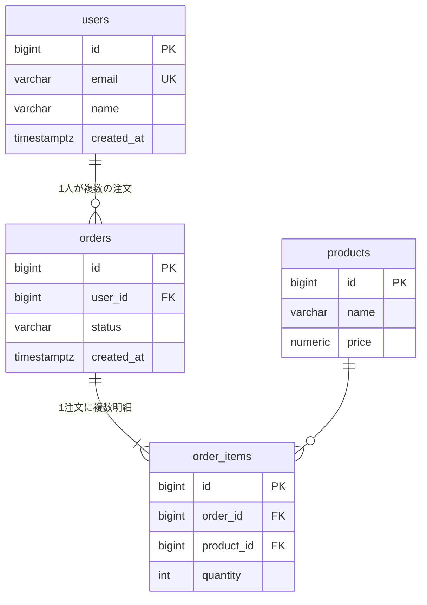

# DB設計書・ER図

| 項目 | 内容 |
|---|---|
| ドキュメントID | DB-001 |
| インプット | 要件定義書 REQ-001 / 基本設計書 BD-001 |
| RDBMS | 例: PostgreSQL 16 |
| バージョン / ステータス | 0.1 ドラフト |

## 1. 設計標準

| 項目 | 標準 |
|---|---|
| テーブル名 | 複数形スネークケース(`users`, `leave_requests`) |
| カラム名 | スネークケース |
| PK | `id` bigint(identity) ※UUIDにする場合は理由を明記 |
| 共通カラム | `created_at`, `updated_at`(timestamptz, NOT NULL) |
| 論理削除 | 使用する場合 `deleted_at`(timestamptz, NULL可)で統一 |
| 日時 | timestamptz でUTC保存 |
| 金額 | numeric |
| ENUM相当 | チェック制約 または マスタテーブル参照 |
| FK | 必ずインデックスを付与 |

## 2. ER図

<!-- テーブルが15を超える場合はサブシステム単位に分割し、全体俯瞰図を別に置く。 -->



## 3. テーブル定義

<!-- 全テーブル分繰り返す。 -->

### 3.1 users(ユーザー)

- **分類**: マスタ / トランザクション / 履歴
- **概要**:
- **想定件数**: 初期○件 → 1年後○件

| カラム名 | 論理名 | 型 | NULL | デフォルト | 制約・説明 |
|---|---|---|---|---|---|
| id | ID | bigint | NO | identity | PK |
| email | メールアドレス | varchar(255) | NO | | UNIQUE |
| created_at | 作成日時 | timestamptz | NO | now() | |
| updated_at | 更新日時 | timestamptz | NO | now() | |

**インデックス**

| インデックス名 | カラム | 種別 | 用途(どの画面・APIの検索か) |
|---|---|---|---|
| | | | |

## 4. 主要クエリ検証

<!-- 一覧・検索・集計画面ごとに想定SQLを書き、インデックスが効くか確認。 -->

### 画面SC-XXX の一覧取得

```sql
SELECT ...
```

- 想定件数と応答目標:
- 使用インデックス:
- N+1回避方法:

## 5. データ移行

| 対象 | 移行元 | 件数 | 方式 | 検証方法 |
|---|---|---|---|---|
| | | | | |

## 6. DDL

<!-- 別ファイル ddl.sql に分けてもよい。マイグレーションツール使用時はその旨記載。 -->

```sql
CREATE TABLE users (
    id bigint GENERATED ALWAYS AS IDENTITY PRIMARY KEY,
    email varchar(255) NOT NULL UNIQUE,
    created_at timestamptz NOT NULL DEFAULT now(),
    updated_at timestamptz NOT NULL DEFAULT now()
);
```

## 7. 未確定事項

| # | 内容 | 決定者 | 期限 |
|---|---|---|---|
| | | | |
