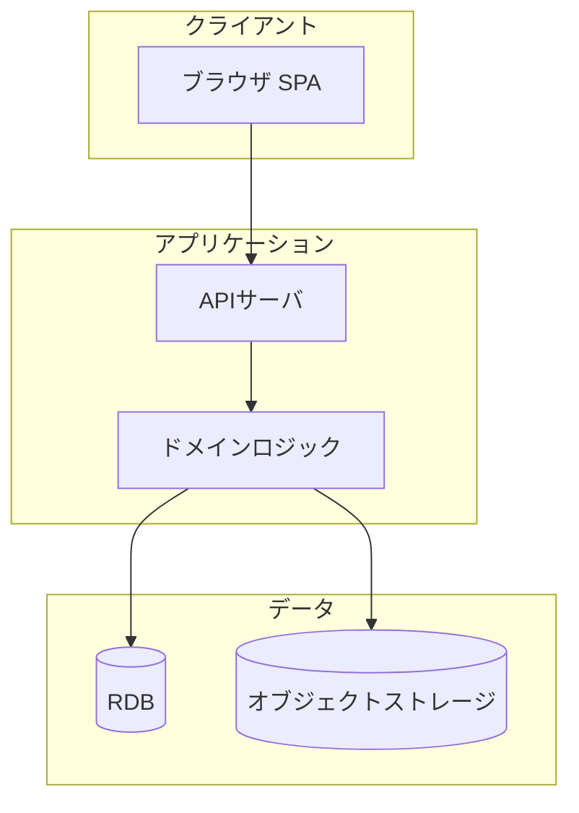
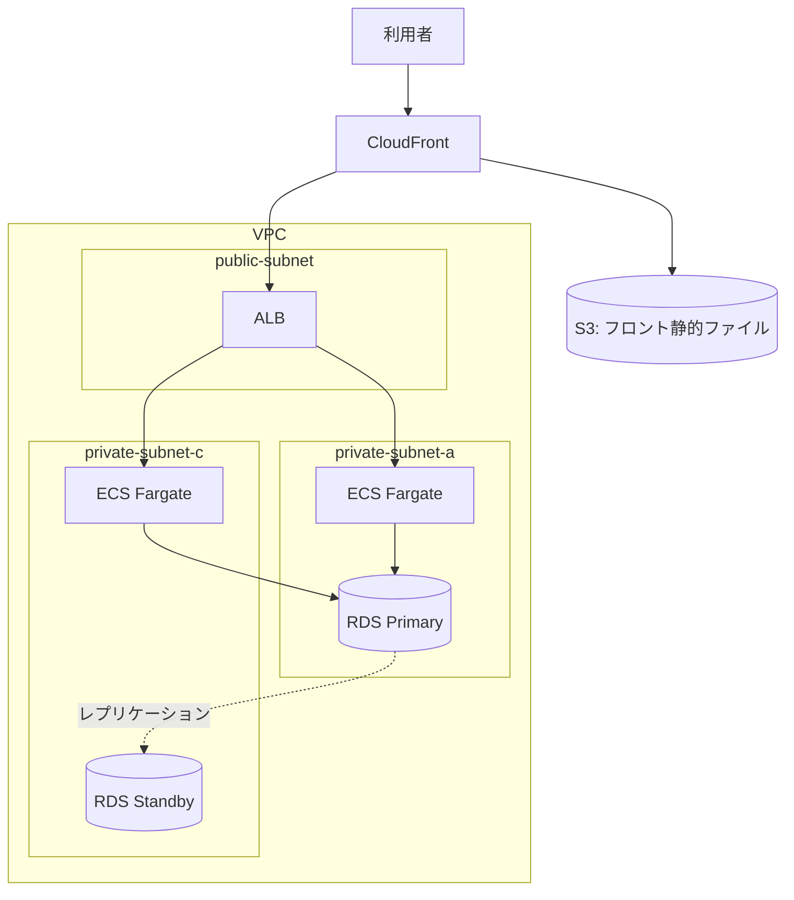
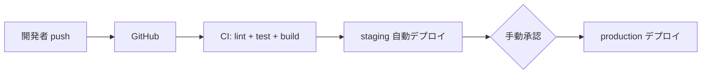

# アーキテクチャ設計書

| 項目 | 内容 |
|---|---|
| ドキュメントID | ARC-001 |
| インプット | 要件定義書 REQ-001 / 非機能要件定義書 NFR-001 |
| バージョン / ステータス | 0.1 ドラフト |

## 1. アーキテクチャ方針

<!-- チーム規模・運用体制を踏まえた方針を3〜5行で。例: 「3人チームのため運用負荷最小を最優先し、
     マネージドサービス中心・モノリス構成とする」 -->

## 2. 技術選定(ADR)

<!-- 重要な選定ごとに繰り返す。 -->

### ADR-001: 【選定対象(例: アプリ実行基盤)】

- **ステータス**: 提案中 / 承認済み
- **決定**: 【選んだもの】

| 選択肢 | メリット | デメリット | 月額目安 |
|---|---|---|---|
| 案A | | | |
| 案B | | | |

- **決定理由**:
- **影響・トレードオフ**: (この選択で諦めたこと)

## 3. 論理アーキテクチャ

## 4. インフラ構成図(AWS例)

### 4.1 環境一覧

| 環境 | 用途 | 構成差分 | AWSアカウント |
|---|---|---|---|
| production | 本番 | Multi-AZ | |
| staging | 検証 | Single-AZ・小サイズ | |
| development | 開発 | ローカル(Docker Compose) | - |

## 5. 非機能要件の実現方式

<!-- NFRの全項目に対応させる。対応しない項目が残ったら設計漏れ。 -->

| 非機能要件(NFR参照) | 実現方式 |
|---|---|
| 稼働率99.5% | Multi-AZ、ALBヘルスチェック、ECS自動再起動 |
| RPO 24h | RDS自動スナップショット(日次)+ WAL |
| API 500ms以内 | オートスケール(CPU70%)、インデックス設計、CloudFrontキャッシュ |
| 通信暗号化 | ACM証明書、TLS1.2以上 |
| Secrets管理 | Secrets Manager(コードへの直書き禁止) |
| 監視 | CloudWatch(下表) |

### 5.1 監視・アラート一覧

| 監視対象 | メトリクス | 閾値 | 通知先 |
|---|---|---|---|
| API | 5xx率 | 1%超5分継続 | Slack #alerts |
| RDS | CPU / 空きストレージ | 80% / 20%未満 | Slack #alerts |
| 外形監視 | ヘルスチェックURL | 失敗2回連続 | Slack + 電話 |

## 6. CI/CD・リリース設計

- ブランチ戦略: 例: GitHub Flow(main + feature branch)
- 本番デプロイ承認者:
- DBマイグレーション手順:
- ロールバック方針: (直前イメージへの切り戻し手順)

## 7. コスト概算

<!-- 「YYYY-MM-DD時点の概算。AWS Pricing Calculatorで再見積り推奨」と明記する。 -->

| リソース | 構成 | 月額(USD) |
|---|---|---|
| ECS Fargate | | |
| RDS | | |
| ALB / CloudFront / S3 | | |
| その他(CloudWatch, Secrets等) | | |
| **本番合計** | | |
| **staging合計** | | |

## 8. 未確定事項

| # | 内容 | 決定者 | 期限 |
|---|---|---|---|
| | | | |
