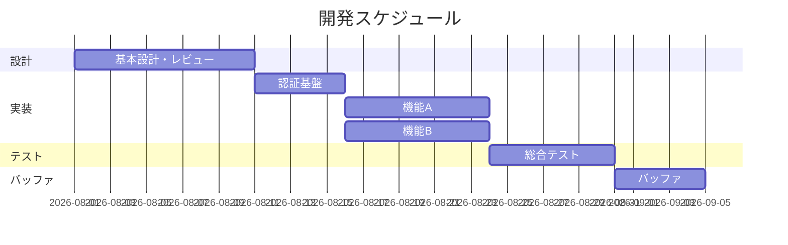

# WBS・開発計画書

| 項目 | 内容 |
|---|---|
| ドキュメントID | PLAN-001 |
| インプット | 要件定義書 REQ-001 / 基本設計書 BD-001 |
| バージョン / ステータス | 0.1 ドラフト |

## 1. 体制

| 名前 | 役割 | 稼働率 | 得意領域 |
|---|---|---|---|
| | PM兼開発 | | |
| | 開発 | | |
| | 開発 | | |

## 2. マイルストーン

| マイルストーン | 日付 | 完了条件 |
|---|---|---|
| 設計承認 | | 基本設計・DB設計・アーキ設計の承認 |
| MUST機能 実装完了 | | |
| 総合テスト完了 | | |
| リリース | | |

## 3. WBS

<!-- ★ルール:
     1. 全タスクは機能ID(F-xxx)または共通基盤IDに紐づける(紐づかないタスク=スコープ外の兆候)
     2. 1タスクは3人日以内。超えるなら分解する
     3. バッファは「隠す」のではなく行として明示する(全体の20%目安)
     4. 見積り合計 > 納期 なら、SHOULD/COULD機能の削減を先に決める(残業で吸収しない) -->

| タスクID | タスク | 機能ID | 担当 | 見積(人日) | 依存 | 状態 |
|---|---|---|---|---|---|---|
| T-001 | 開発環境構築(Docker, CI) | 共通 | | 2 | - | |
| T-002 | 認証基盤実装 | F-001 | | 3 | T-001 | |
| ... | | | | | | |
| T-9xx | バッファ(全体の20%) | - | - | | | |

**見積り合計: ○人日 / 利用可能: ○人日(3人×○日×稼働率)**

## 4. ガントチャート

## 5. リスク管理表

| # | リスク | 発生可能性 | 影響 | 対策(予防/発生時) | 担当 |
|---|---|---|---|---|---|
| 1 | 例: 外部API仕様が未確定 | 高 | 大 | ○日までに確定させる/モックで先行 | |

## 6. 変更管理ルール

<!-- ★タスク膨張の防止装置。 -->

1. 新しい要望・仕様変更は、まず課題管理表に起票する(即実装しない)
2. 影響見積り(人日)を出し、「納期をずらす」「他機能を削る」「次リリースに回す」のいずれかをセットで決める
3. 決定は週次定例で行い、要件定義書・WBSを改訂してから着手する

## 7. 進捗管理

- 週次: 定例で WBS更新 + バーンダウン確認
- 遅延判定: 予定より2人日以上遅れたタスクは即エスカレーション(抱え込み禁止)
