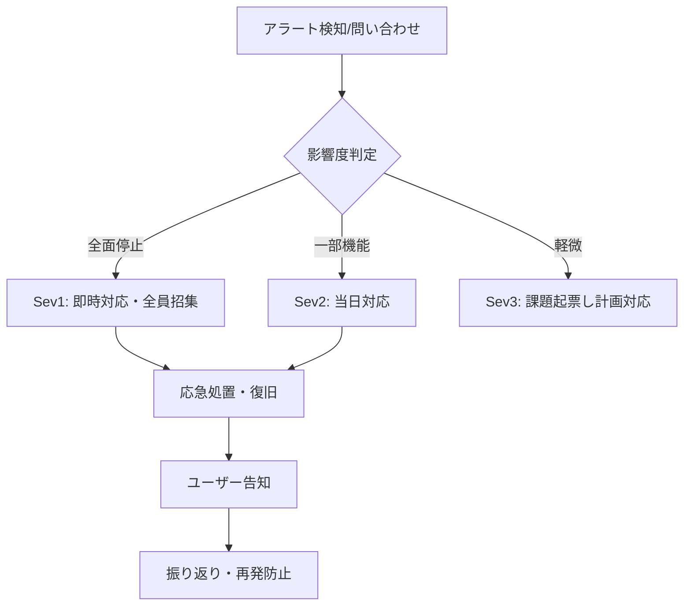

# 運用設計書

| 項目 | 内容 |
|---|---|
| ドキュメントID | OPS-001 |
| インプット | アーキテクチャ設計書 ARC-001 / 非機能要件定義書 NFR-001 |
| バージョン / ステータス | 0.1 ドラフト |

## 1. 運用体制

| 役割 | 担当 | 対応時間 |
|---|---|---|
| 一次対応(アラート受信) | | 例: 平日9-18時 |
| エスカレーション先 | | |

## 2. リリース手順

1. リリース判定(テスト計画書の基準を満たすこと)
2. リリースノート作成・ユーザー告知(必要時)
3. DBマイグレーション適用
4. デプロイ実行(CI/CDパイプライン、承認者: ○○)
5. リリース後確認(ヘルスチェック、主要動線のスモークテスト)
6. 問題発生時: ロールバック手順(アーキテクチャ設計書 §6)

## 3. 障害対応フロー

- 障害記録: 発生時刻・影響範囲・原因・対応・再発防止を必ず記録(テンプレは別紙)

## 4. 定期運用作業

| 作業 | 頻度 | 担当 | 手順 |
|---|---|---|---|
| バックアップ確認 | 週次 | | |
| リストア演習 | 半期 | | |
| 依存パッケージ更新 | 月次 | | |
| 証明書・ドメイン期限確認 | 自動+月次目視 | | |
| コスト確認 | 月次 | | |

## 5. バックアップ・リストア

| 対象 | 方式 | 頻度 | 保持 | リストア手順 |
|---|---|---|---|---|
| DB | 自動スナップショット | 日次 | 30日 | |
| ファイル | S3バージョニング | 常時 | | |

## 6. アカウント・権限管理

- 入退場時の手順: (アカウント発行・削除のチェックリスト)
- 本番アクセス権: (誰が持つか、最小権限)

## 7. ユーザーサポート

- 問い合わせ窓口:
- FAQ / マニュアルの場所:
