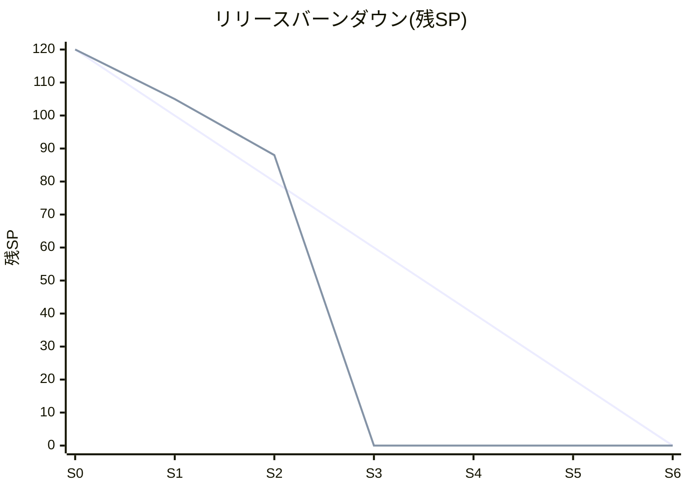

# リリース計画書(納期予測)

| 項目 | 内容 |
|---|---|
| ドキュメントID | RP-001 |
| インプット | プロダクトバックログ PBL-001(ポーカー済みSP) |
| 予測実施日 | 【毎スプリント末に更新】 |
| ステータス | |

## 1. 前提条件

| 項目 | 値 |
|---|---|
| チーム | 3名 × 稼働率【 】% |
| スプリント長 | 2週間(営業日10日) |
| Sprint 1 開始日 | |
| 総SP(残SP) | |
| 除外期間 | 例: 年末年始、GW、メンバ休暇予定 |

## 2. ベロシティ

### 2.1 実績(毎スプリント追記)

| スプリント | 計画SP | 完了SP | 持ち越し | 備考(休暇・割込み等) |
|---|---|---|---|---|
| Sprint 1 | | | | |

### 2.2 予測に使うベロシティ

<!-- 実績3スプリント未満の間は初期仮説を使う。計算過程を必ず残す。 -->

**初期仮説の計算(実績が貯まるまで)**

```
スプリントあたり総工数 = 3人 × 10営業日 = 30人日
フォーカスファクター   = 0.6(MTG・レビュー・割込みを考慮)
実効人日              = 30 × 0.6 = 18人日
SP↔人日レート         = 基準ストーリー(3SP)≒ 2.5人日 → 1SP ≒ 0.83人日
仮ベロシティ(標準)    = 18 ÷ 0.83 ≒ 21SP/スプリント
幅                    = ±30% → 悲観15 / 標準21 / 楽観27
Sprint 1〜2 は立ち上げ補正 ×0.75
```

| シナリオ | ベロシティ |
|---|---|
| 悲観 | |
| 標準 | |
| 楽観 | |

## 3. 納期予測(3点予測)

<!-- 必要スプリント数 = ceil(残SP ÷ ベロシティ)。日付はスプリント境界+祝日確認。 -->

| シナリオ | 計算 | 必要スプリント | 完了予定日 |
|---|---|---|---|
| 楽観 | | | |
| **標準** | | | |
| 悲観 | | | |

- **対外提示日**: 標準〜悲観の間で設定(楽観値を約束しない)
- **MUSTのみの最小リリース**: 残MUST SP【 】÷ 標準V = 【 】スプリント → 【日付】

### 3.1 締切からの逆算(希望納期がある場合)

```
締切: 【日付】 → 残り【N】スプリント
消化可能SP = N × 標準ベロシティ = 【 】SP
バックログ優先順の積み上げで【US-xxx】までがライン内
→ ライン外のMUST: 【なし/あり→対応方針(スコープ削減/納期延伸)】
```

## 4. スプリント割当て案

<!-- 配置原則: Sprint 0=基盤 / リスク高・不確実は前半 / 最終前にハードニング -->

| スプリント | 期間 | ゴール(1文) | 主なストーリー | SP |
|---|---|---|---|---|
| Sprint 0 | | 開発の土台ができ、hello worldが本番相当環境で動く | US-101, US-102... | |
| Sprint 1 | | | | |
| ... | | | | |
| Sprint N-1 | | ハードニング(バグ修正・性能・リリース準備) | | V×0.5だけ計上 |
| Sprint N | | リリース | | |

## 5. リリースバーンダウン

<!-- 毎スプリント末に実績を追記して更新。理想線と実績線の乖離が2スプリント続いたら再計画。 -->



※1本目=理想線、2本目=実績(未来は0のまま)

## 6. 再計画のトリガー(いずれかで即、本書を更新して共有)

- 実績ベロシティが仮説から±30%以上乖離(2スプリント連続)
- バックログに合計【20】SP以上の追加(変更管理ルール経由)
- メンバの離脱・長期休暇の確定
- 悲観シナリオでも締切に収まらなくなった時点(**発覚した日に共有。月末まで温めない**)

## 7. リスクと対応

| # | リスク | 影響(SP/日数) | 対策 |
|---|---|---|---|
| 1 | | | |
